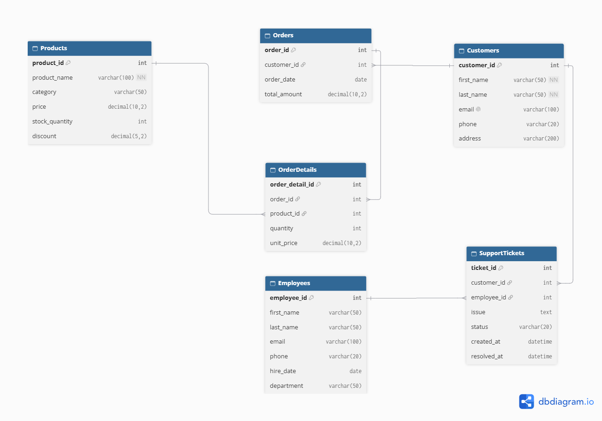

# TechCorp SQL Analysis


> SQL-based analysis of sales, customers, products, and support data using MySQL.

## Table of Contents
1. [Project Overview](#1-project-overview)
2. [Business Background](#2-business-background)
3. [Project Objectives](#3-project-objectives)
4. [Database Structure](#4-database-structure)
5. [SQL Analysis](#5-sql-analysis)
6. [Key Findings](#6-key-findings)
7. [Tools & Technologies](#7-tools--technologies)
8. [Screenshots](#8-screenshots)

---

## 1. Project Overview

This project builds a relational database for **TechCorp**, a fictional tech retailer, and uses SQL to turn raw transaction and support data into business insights. It covers the full workflow: designing the schema, loading sample data, and writing analytical queries.

| File | Purpose |
|---|---|
| `01_database_setup.sql` | Creates the database and all tables |
| `02_data_insertion.sql` | Inserts sample data |
| `03_data_analysis.sql` | Business analysis queries |

## 2. Business Background

TechCorp sells laptops, smartphones, and accessories. Like most retailers, the management team needs clear answers to everyday questions:

- Which customers generate the most revenue?
- Which products sell well, and which never sell?
- How well is the support team handling customer issues?

Without a structured database and analysis, these questions are hard to answer reliably.

## 3. Project Objectives

- Design a normalized database that connects customers, orders, products, employees, and support tickets.
- Identify top customers and understand customer spending behavior.
- Evaluate product performance and pricing across categories.
- Measure support team productivity through ticket resolution.
- Practice core SQL skills: joins, aggregation, CTEs, and subqueries.

## 4. Database Structure

The `techcorp` database has six tables.

| Table | Description |
|---|---|
| `Products` | Product catalog with category, price, stock, and discount |
| `Customers` | Customer contact information |
| `Orders` | Order headers linked to customers |
| `OrderDetails` | Line items linking orders to products |
| `Employees` | Employee data with department and hire date |
| `SupportTickets` | Customer issues handled by employees |

**Relationships**
- `Orders.customer_id` → `Customers.customer_id`
- `OrderDetails.order_id` → `Orders.order_id`
- `OrderDetails.product_id` → `Products.product_id`
- `SupportTickets.customer_id` → `Customers.customer_id`
- `SupportTickets.employee_id` → `Employees.employee_id`



## 5. SQL Analysis

### 5.1 Top 3 customers by total order amount
```sql
SELECT c.first_name, c.last_name,
       SUM(o.total_amount) AS total_order_amount
FROM Customers c
JOIN Orders o ON o.customer_id = c.customer_id
GROUP BY c.customer_id
ORDER BY total_order_amount DESC
LIMIT 3;
```

### 5.2 Average order value per customer
```sql
SELECT c.first_name, c.last_name,
       AVG(o.total_amount) AS average_order
FROM Customers c
JOIN Orders o ON c.customer_id = o.customer_id
GROUP BY c.customer_id;
```

### 5.3 Employees with more than 4 resolved tickets
```sql
SELECT e.first_name, e.last_name,
       COUNT(s.ticket_id) AS resolved_tickets
FROM Employees e
JOIN SupportTickets s ON e.employee_id = s.employee_id
WHERE s.status = 'resolved'
GROUP BY e.employee_id
HAVING COUNT(s.ticket_id) > 4;
```

### 5.4 Products that have never been ordered
```sql
SELECT p.product_name
FROM Products p
LEFT JOIN OrderDetails od ON od.product_id = p.product_id
WHERE od.order_id IS NULL;
```

### 5.5 Total revenue
```sql
SELECT SUM(quantity * unit_price) AS total_revenue
FROM OrderDetails;
```

### 5.6 Average price per product category (CTE)
```sql
WITH cte_avg_price AS (
    SELECT category, AVG(price) AS average_price
    FROM Products
    GROUP BY category
)
SELECT * FROM cte_avg_price;
```

### 5.7 Customers with an order above 1,000 (subquery)
```sql
SELECT *
FROM Customers
WHERE customer_id IN (
    SELECT customer_id
    FROM Orders
    WHERE total_amount > 1000
);
```

## 6. Key Findings

| Question | Finding |
|---|---|
| Top customer | John Doe is the highest spender with 3,535 across two orders, followed by Jane Smith (1,135) and Michael Brown (300) |
| Order size | John Doe also has the highest average order value (1,767.50) |
| High-value orders | Only John Doe has placed an order above 1,000 |
| Support performance | Alice Williams is the only employee with more than 4 resolved tickets (5 in total) |
| Unsold product | Wireless Earphones has never been ordered |
| Category pricing | Laptop averages 1,750, Smartphone 550, and Accessories 73.75 |

**Business takeaways**
- Revenue is concentrated in a few customers, so retention of top customers matters.
- Wireless Earphones may need a promotion or a price review.
- Support workload is uneven across the team and could be balanced better.

## 7. Tools & Technologies

- **MySQL** and **MySQL Workbench** for database design and querying
- **SQL** (DDL, DML, joins, aggregation, CTE, subqueries)
- **Git** and **GitHub** for version control and publishing


## Author

**Debby Octaviani**
Physics graduate, Universitas Negeri Jakarta
GitHub: [@debbyoctaviani](https://github.com/debbyoctaviani)
